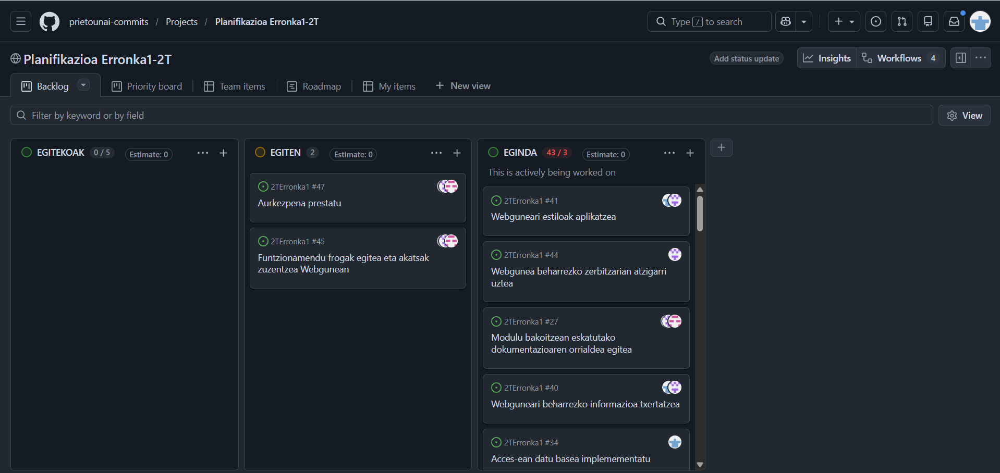
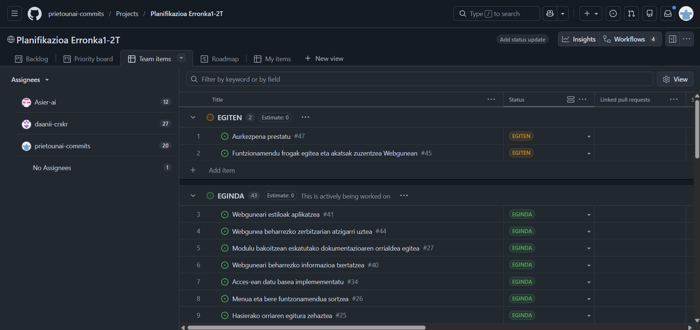
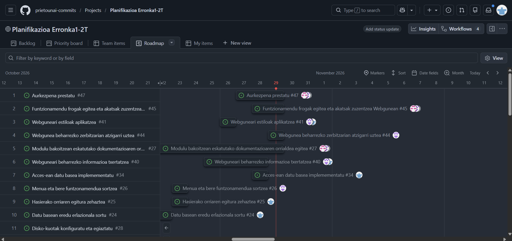

Digitalizazioa prozesu, produktu eta zerbitzu tradizionalak teknologia digitalak erabiliz eraldatzea da. Enpresetan, informazio analogikoa —hitzak, irudiak edo zenbakizko datuak— formatu digitalera pasatzea eta lehen eskuz edo paperean egiten ziren lanak baliabide digitalen bidez egitea barne hartzen du.

Digitalizatzea ez da zereginak informatizatzea bakarrik: enpresak nola lan egiten duen, nola ekoizten duen eta erabakiak nola hartzen dituen alda dezake. Horretarako, teknologia enpresaren jardueran ondo txertatu behar da, eta langileek tresna eta lan egiteko modu berrietara egokitu behar dute.

## Enpresek digitalizatzearen arrazoiak eta onurak
---
Digitalizazioak hainbat onura ekar ditzake:

- **Eraginkortasuna eta zehaztasuna handitzea:** zereginak azkarrago egin eta eskuzko akatsak gutxitu daitezke.
- **Bezeroekiko komunikazioa hobetzea:** bezeroen galderei eta eskaerei azkarrago erantzuteko aukera ematen du.
- **Informaziorako sarbidea eta koordinazioa erraztea:** langileek informazioa azkar aurki dezakete, eta taldeek kokapen desberdinetatik lan egin dezakete.
- **Datuetan oinarritutako erabakiak hartzea:** datu eguneratuek arazoak antzematen eta jarduera hobetzen lagun dezakete.
- **Negozio-aukera berriak sortzea:** online salmenta, prestakuntza digitala eta hodeiko software-zerbitzuak dira aukera horien adibide.

## Enpresa digitalizatzeko moduak
---
Enpresa batek digitalizazioa hainbat modutan ezar dezake:

- Paperezko dokumentuak fitxategi digital bihurtuz.
- Zeregin eta prozesu errepikakorrak software bidez automatizatuz.
- Posta elektronikoa, txata eta berehalako mezularitza erabiliz.
- Datuak hodeian biltegiratuz eta baimendutako pertsonekin partekatuz.
- Salerosketak plataforma digitalen bidez eginez.
- Datuak bildu eta aztertuz.
- Gailuak eta sentsoreak Internetera konektatuz.
- Errealitate birtuala eta areagotua erabiliz simulazio eta esperientzia digitalak sortzeko.

Digitalizazioak lanpostuetan, zereginetan, komunikazioan eta enpresaren antolaketan eragina izan dezake. Zeregin errepikakor batzuk automatiza daitezke, baina teknologia erabiltzeko, programatzeko eta mantentzeko lan berriak ere sor daitezke.

# 2. IT eta OT teknologiak
---
Produkzio-sektorean bi teknologia-talde nagusi daude: IT eta OT. Biek digitalizazioan eta enpresaren eraginkortasunean laguntzen dute, baina helburu desberdinak dituzte.

## IT: informazio-teknologiak

IT (Information Technology) datuak prozesatzeko eta informazioa kudeatzeko erabiltzen diren tresna digitalak dira. Enpresaren informazioa antolatzen, partekatzen eta aztertzen laguntzen dute.

IT teknologien adibideak dira softwarea, sareak, datu-baseak, aplikazio informatikoak eta hodeiko plataformak.

## OT: operazio-teknologiak

OT (Operational Technology) prozesu fisikoak eta eragiketa industrialak kontrolatzeko eta automatizatzeko erabiltzen diren gailu eta sistemak dira. Makinen eta produkzio-eragiketen funtzionamenduari lotuta daude.

OT teknologien adibideak dira sentsoreak, termostatoak, beso robotikoak, kontrolagailu industrialak eta automatizazio-sistemak. PLCak prozesu industrialak kontrolatzeko programatzen diren gailuak dira; SCADA sistemek, berriz, instalazio eta ekipo industrialak monitorizatu eta kontrolatzeko balio dute.

| Ezaugarria | IT | OT |
|---|---|---|
| Helburua | Informazioa eta enpresako datuak kudeatzea | Prozesu fisikoak eta eragiketa industrialak kontrolatzea |
| Ohiko teknologiak | Softwarea, sareak, datu-baseak eta aplikazioak | Sentsoreak, kontrolagailuak eta automatizazio-sistemak |
| Segurtasuna | Datuak eta sistema informatikoak babestea | Sistema industrialak eta prozesu fisikoak babestea |
| Bizi-zikloa | Eguneratze teknologikoen ondorioz, laburragoa izan ohi da | Ekipamenduen kostua eta ekoizpenaren beharrak direla eta, luzeagoa izan ohi da |

ITk eta OTk datuak maneiatzen dituzte eta sistemen arteko konexioa behar dute, baina datu horien erabilera desberdina da. IT eta OT integratzean, produkzio-ekipoek sortutako informazioa enpresako sistema informatikoekin parteka daiteke. Horrek ekoizpena denbora errealean monitorizatzen, arazoak lehenago antzematen, mantentze-lanak planifikatzen eta baliabideak hobeto erabiltzen laguntzen du. Bi arloetako taldeen lankidetza beharrezkoa da integrazioa modu eraginkor eta seguruan egiteko.

# 3. Teknologia Gaitzaile Digitalak (TGD)
---
Teknologia Gaitzaile Digitalak eraldaketa digitala ahalbidetzen duten teknologiak dira. Gaitasun eta negozio-eredu berriak garatzen laguntzen dute, eta berrikuntza, eraginkortasuna eta lehiakortasuna bultzatzen dituzte. 4.0 Industriaren oinarrietako batzuk dira.

## TGD nagusiak

- **Gauzen Internet (IoT):** objektu eta gailu fisikoak Internetera konektatzen ditu, datuak biltzeko eta prozesuak automatizatzeko.
- **Adimen Artifiziala (AA edo IA):** makinek ikasi, arrazoitu edo erabakiak hartzeko erabiltzen diren algoritmo eta teknikak.
- **Big Data eta datuen analisia:** datu-bolumen handiak bildu, gorde eta aztertzeko aukera ematen dute.
- **Cloud computing edo hodeiko konputazioa:** datuak eta aplikazioak Internet bidez biltegiratu eta prozesatzeko aukera ematen du.
- **Zibersegurtasuna:** sistemak, sareak eta datuak mehatxu zibernetikoetatik babesteko teknologiak eta jardunbideak.
- **Errealitate areagotua eta errealitate birtuala:** errealitate areagotuak ingurune errealean elementu digitalak gehitzen ditu; errealitate birtualak, berriz, ingurune simulatu bat sortzen du.
- **Blockchain:** transakzioen erregistro deszentralizatua eta segurua eskaintzen duen teknologia.
- **5G:** konektibitate azkarragoa eta fidagarriagoa eskaintzen duen sare mugikorren belaunaldia.
- **Robotika:** robotak eta automatizazio robotikoa erabiltzen ditu zeregin eta prozesuak egiteko.
- **3D inprimaketa:** hiru dimentsioko objektuak fabrikatzeko teknologia.
- **Biometria:** pertsonak identifikatzeko hatz-markak, aurpegia edo ahotsa bezalako ezaugarriak erabiltzen ditu.

## TGD-en ezaugarriak eta enpresetako aplikazioak

TGDak askotariko sektore eta testuinguruetan erabil daitezke. Zereginak automatizatu, gailu eta sistemak konektatu, datuak denbora errealean aztertu eta erabiltzaile edo bezero bakoitzaren beharretara egokitutako zerbitzuak eskaintzea ahalbidetzen dute. Beharren arabera eskala daitezke eta produktu, zerbitzu edo negozio-eredu berriak sortzeko bidea eman dezakete.

Produkzio-sektorean, TGDak ekoizpen-prozesuak automatizatzeko, kalitate-kontrola hobetzeko, hornidura-katea kudeatzeko eta aktiboak monitorizatzeko erabil daitezke. Logistikan, bidalketen jarraipena eta ibilbideen plangintza egiteko balio dute; energian, kontsumoa optimizatzeko; eta osasunean, pazienteak urrunetik monitorizatzeko, besteak beste.

## TGD-en ingurumen-eragina

TGDek ingurumenari mesede egin diezaiokete: paper gutxiago erabiltzea, energia modu eraginkorragoan kudeatzea, telelanaren bidez joan-etorriak murriztea eta ingurumen-datuak hobeto monitorizatzea ahalbidetzen dute.

Aldi berean, gailu elektronikoen hondakinak, fabrikazioaren eta erabileraren karbono-aztarna, datu-zentroetako energia-kontsumoa eta gailuak ekoizteko baliabide naturalen erabilera handitu ditzakete. Horregatik, enpresek hondakinak kudeatu, karbono-aztarna murriztu eta baliabideak arduraz erabili behar dituzte.

## 4. GitHub-en erabilera

Erronka osoa garatzeko eta antolatzeko, GitHub erabili dugu. Tresna honen bidez, dokumentazioa sortu, enpresaren webgunea garatu eta lanaren planifikazioa egin dugu.

### 4.1. Dokumentazioa

Dokumentazioa Markdown (`.md`) formatuan sortu dugu. Formatu honek informazioa modu argi eta antolatuan idazteko aukera ematen digu. Dokumentazio-fitxategiak GitHub-eko biltegian gorde ditugu, proiektuaren informazio guztia leku berean izateko.

### 4.2. Enpresaren webgunea

GitHub erabili dugu enpresaren webgunea sortzeko eta haren fitxategiak biltegian gordetzeko.Enpresaren webgunea sortzeko, HTML eta CSS erabili ditugu. Horrela, webgunearen garapena eta proiektuaren gainerako fitxategiak batera antolatu ditugu.

### 4.3. Lanaren planifikazioa

Erronkako zereginak antolatzeko, GitHub-eko biltegiaren barruan Project berri bat sortu dugu, eta Kanban eredua erabili dugu.

Kanban taularen bidez, zereginak hiru egoeratan banatu ditugu:

- **Egin beharrekoak:** oraindik hasi ez diren zereginak.
- **Egiten ari direnak:** une horretan lantzen ari garen zereginak.
- **Eginda:** amaitutako zereginak.

    
    

     [2T- ERRONKA1 PLANIFIKAZIOA (link-a)](https://github.com/users/prietounai-commits/projects/8/views/1)

Bestalde, **Roadmap-a** erabili dugu zereginak denboran zehar antolatzeko. Horri esker, zeregin bakoitza noiz egin dugun zehaztu eta erronkaren garapenaren denbora-plangintza ikusi ahal izan dugu.
        

Antolaketa honi esker, zereginen egoera kontrolatu, lanaren jarraipena egin eta erronkaren garapena modu eraginkorragoan planifikatu dugu.