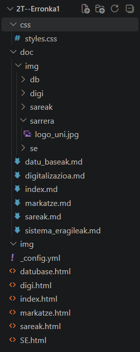

### SARRERA

Lan honen helburua informatikako erronkan landutako edukiak webgune batean biltzea da. Webgunearen egitura sortzeko HTML erabili dugu, eta itxura diseinatzeko, CSS. Sei atal ditu: Hasiera, Sareak, Sistemak, Marketzea, Datu-baseak eta Digitalizazioa.

### ERABILI DITUGUN PROGRAMAK

- **HTML:** Testuak, izenburuak, irudiak eta estekak gehitzeko.
- **CSS:** Koloreak, tamainak, botoiak eta elementuen kokapena zehazteko.
- **Visual Studio Code:** Kodea idatzi eta editatzeko.
- **GitHub:** Fitxategiak gordetzeko eta lana antolatzeko.

### KARPETA ETA FITXATEGIEN EGITURA

### HTML ETIKETAK

- **`<!DOCTYPE html>`**: Dokumentua HTML5 formatuan dagoela adierazten du.
- **`<html lang="en">`**: HTML dokumentua hasten du eta hizkuntza ingelesa dela adierazten du.
- **`<head>`**: Orriaren konfigurazioa eta metadatuak biltzen ditu.
- **`<meta charset="UTF-8">`**: Testuko karaktereak behar bezala erakusteko kodeketa zehazten du.
- **`<meta name="viewport">`**: Orria pantaila eta gailu desberdinetara egokitzen laguntzen du.
- **`<title>`**: Nabigatzaileko fitxan agertzen den izenburua zehazten du.
- **`<link>`**: HTML dokumentua CSS fitxategiarekin lotzen du.
- **`<header>`**: Orriaren goiburuko edukia biltzen du.
- **`<nav>`**: Nabigazio-menua sortzen du.
- **`<main>`**: Orriaren eduki nagusia adierazten du.
- **`<b>`**: Testua lodiz erakusten du.
- **`<ul>`**: Ordenarik gabeko zerrenda sortzen du.
- **`<li>`**: Zerrendako elementu bat adierazten du.
- **`<a href="...">`**: Beste orri batera doan esteka sortzen du.
- **`<body>`**: Web-orrian ikusgai dagoen edukia biltzen du.
- **`<h1>` eta `<h2>`**: Lehen eta bigarren mailako izenburuak sortzen dituzte.
- **`<section>`**: Edukiaren atal bat biltzen du.
- **`
`**: Paragrafo bat sortzen du.
- **` `**: Lerro-jauzia txertatzen du.
- **`<footer>`**: Orriaren beheko zatiko edukia biltzen du.

### CSS PROPIETATEAK

- **`font-family`**: Testuaren letra mota zehazten du.
- **`background-color`**: Atzeko planoaren kolorea ezartzen du.
- **`color`**: Testuaren kolorea zehazten du.
- **`font-size`**: Letra-tamaina ezartzen du.
- **`font-weight`**: Letraren lodiera zehazten du.
- **`margin`**: Elementuaren kanpoko tartea ezartzen du.
- **`margin-left` eta `margin-right`**: Ezkerreko eta eskuineko kanpoko tarteak zehazten dituzte.
- **`margin-bottom` eta `margin-top`**: Beheko eta goiko kanpoko tarteak ezartzen dituzte.
- **`padding`**: Elementuaren barruko tartea ezartzen du.
- **`width`**: Elementuaren zabalera zehazten du.
- **`height`**: Elementuaren altuera zehazten du.
- **`box-sizing`**: Zabalera eta altuera nola kalkulatzen diren zehazten du.
- **`text-align`**: Testua horizontalki lerrokatzen du.
- **`line-height`**: Testu-lerroen arteko tartea zehazten du.
- **`letter-spacing`**: Letren arteko tartea aldatzen du.
- **`display`**: Elementua orrian nola erakusten den zehazten du.
- **`list-style-type`**: Zerrendako ikurrak zehazten ditu.
- **`text-decoration`**: Testuaren azpimarra edo beste apaingarri bat zehazten du.
- **`border`**: Elementuaren ertza ezartzen du.
- **`border-collapse`**: Taulako gelaxken ertzak elkartzen ditu.
- **`cursor`**: Saguaren erakuslearen itxura aldatzen du.
- **`bottom`**: Elementu baten beheko kokapena ezartzen du.
- **`justify-content`**: Flex elementuak lerrokatzen ditu.
- **`gap`**: Elementuen arteko tartea ezartzen du.

